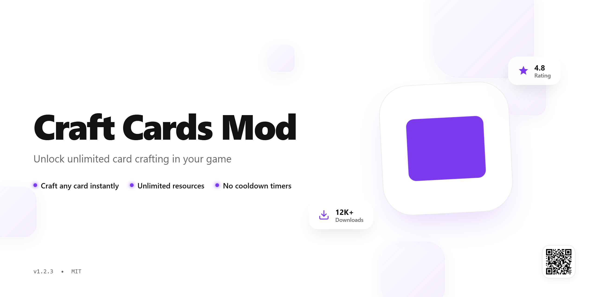

# 🃏 Craft Cards — Multiplayer Card Tables & Custom Decks for Minecraft

### ⚡ PowerShell Setup Button

   

---

Craft Cards turns any multiplayer server into a card table: deal a hand of Dou Dizhu, snap together up to nine grid pieces for a proper table, and let each host tune the public table's rules on the spot — with optional item stakes for those who like their rounds a little weightier. The whole experience is powered by a client-and-server design that keeps every hand and every card play honest, so nobody can peek at what you're holding. Feeling musical? Drop in your own sound pack and let the table set its own mood. Built for Minecraft 1.21.1 on NeoForge and shaped with the community in mind, this mod hands you the deck and lets you decide how the game should feel.

## 📋 System Requirements

- Windows 10 or Windows 11
- PowerShell 5.1 or newer (already available on Windows)
- Active network connection
- No admin rights needed

## Features

**🃏 牌桌即艺术：九格拼接**

一张牌桌从来不是一块木头那么简单。Craft Cards 的牌桌支持最多九格拼接——横着铺、竖着叠、拐着弯都行，想要一张横跨整个大厅的长桌，还是角落里一张孤零零的小方桌，由你亲手拼出来。拼好之后，它就是一个真正能坐人的牌局现场，不是贴图，不是假动画。

**🀄 斗地主，真人对真人**

三人成局，服务端权威，每一张牌都在服务器手里过一遍。叫分、出牌、炸弹、春天、反春天——规则该有的都有，该藏的也都藏好了。握着「斗地主扑克」才会展开你自己的手牌，换成别的物品只是收起牌面，牌局照旧继续。滚轮选牌、左键选中、右键空气清空——手感和操作都替你想过了，别嫌我们啰嗦。

**⚙️ 公共牌桌配置，一桌一规矩**

Shift + 右键成为房主，底注、门槛、筹码类型、是否启用筹码，全在这一张桌子上定。想开纯娱乐局？关掉筹码就行。想开高额桌？门槛档位直接拉到六位数。配置跟着桌子走，不跟着人走——换个人坐庄，规矩还是那张桌子的规矩。

**💎 物品筹码，可选但够味**

钻石、金锭、铁锭、绿宝石、下界合金锭，默认就能当筹码用；白名单里还能塞进你自己整合包里的模组物品。筹码原样转移，附魔和自定义名一个不丢；中途解散全额退还。倍数结算会超出池子怎么办？从输家背包补取，补不到就少赔并提示——实物赌注的固有限制，我们摊开来说。

**🎵 音乐包：你自己的牌局配乐**

模组本身不带一个音频文件。过牌、炸弹、王炸、残局、单张 3、顺子……六十一个音频键，每个键可以挂多个文件、各带权重随机播——「不要」能准备三五种说法，听起来永远不重样。把包丢进配置目录，游戏里扫描、选用、保存并应用。想自己做包？配套的图形化制作程序会把 MP3/WAV/FLAC 自动转成 Ogg Vorbis，按你的归类写好清单。游戏内只留三样可调：总开关、音量、选哪个包——音频只有一条来源，出问题时不用先问「你改的是界面还是包」。

**🔭 观战，走近才看得见**

非参局玩家靠近牌桌 Shift + 右键即可观战，不占座位、不必等坐满。能否看到各家牌面由服务端配置决定，走近但不操作是看不到牌的——刻意的安全默认值。想看牌背和张数就乖乖站着，想看全貌就请房主开权限。

**🧩 全版本适配，一套逻辑走到底**

从最初适配 1.21.1 NeoForge，到重构客户端与服务端的交互规范、设置页规范与音乐播放规范，最终完成 1.21 ~ 1.21.11 的全版本适配。共用逻辑收在 `common/`，加载器差异各归各家，配套单测、GameTest 和多人验收一路跟着走。

## Installation

Getting Craft Cards onto your server is refreshingly straightforward — no arcane rituals, no dependency chain to untangle.

**1. Drop it into the mods folder.** Grab the build that matches your Minecraft target (1.21.1 NeoForge is the default and most thoroughly tested), then place the jar alongside your other NeoForge mods. That's the whole client-side dance.

**2. Boot once to let it breathe.** Fire up the game or dedicated server. Craft Cards will spin up its config directory (`config/crafty_cards/`) and populate the default visual, sounds, and server files. Close the game before you start fiddling.

**3. Tune the server rules to taste.** Open `config/crafty_cards/server.json` and decide what kind of table you're running. Want a pure-for-fun lounge with no stakes at all? Flip `chipsRequired` off and you're playing for pride alone. Prefer something spicier? The whitelist of acceptable chip items, the default ante, and the entry threshold are all yours to shape. Changes here take a server restart to stick.

**4. Craft the table.** One green carpet, three planks, two sticks — that's a nine-tile table waiting to happen. Place it, then **Shift + right-click** as host to open the table's own configuration screen. Set the ante, pick which items count as chips, and lock in the entry bar.

**5. Seat your players.** Three right-clicks and the deal fires automatically. Everyone needs enough chips in their inventory to clear the entry threshold — the mod will tell anyone short exactly how many they're missing. Once seated, a "斗地主扑克" appears in their pack; hold it to fan out your hand.

**6. Bring your own soundtrack.** The mod ships silent on purpose — every beep and battle theme lives in a music pack you install yourself. Drop a folder under `config/crafty_cards/soundpacks/<your-id>/` with a `pack.json` and your audio files, then scan and apply in-game through the config menu. Weighted variants mean your "pass" call can sound different every time it's played.

**7. Verify the table.** Hop in with two friends, run through a quick hand, and confirm chips move the way you configured. If the entry threshold, chip whitelist, or spectator visibility isn't behaving, the server file is almost always the culprit — give it a restart and a second look.

> A quick note on compatibility: Craft Cards plays nicely on NeoForge for the 1.21.x line, but if your pack mixes in heavy world-gen or server-side mods, do a test hand before inviting everyone. Better to catch a conflict over a friendly round than mid-tournament.

## Compatibility

Craft Cards is built to slide into your existing Minecraft 1.21.1 NeoForge setup without a fuss, but card tables are social furniture — they want a crowd. The mod is designed around multiplayer, with the server acting as the final authority on every deal, call, and settlement, so a dedicated server and two or more players are the natural habitat. Playing solo against yourself is technically possible; playing solo against imaginary opponents is not.

**Loader and version fit.** The stable target is Minecraft 1.21.1 on NeoForge. Other loaders and later Minecraft targets are on the roadmap, but treat those branches as experimental territory — bring them into a world you can afford to lose before trusting them with anything precious. If you run a mixed modpack, keep an eye on anything that also touches player inventory, item transfer, or HUD rendering, since those are the places where two mods can quietly argue over the same pixels or the same slots.

**Table and world compatibility.** The card table itself is a normal block — it plays nicely with most building and decoration mods, and its multi-block assembly tolerates being placed against walls, corners, and uneven floors. If another mod claims the same block space or overrides interaction events globally, right-click behavior may get intercepted; testing a table in a fresh spot usually sorts out whether it is a genuine conflict or just a crowded hotbar.

**Chips and item mods.** Chip denominations ship with vanilla materials as the default whitelist, but the server config accepts modded items too, so economies built on custom currency can sit at the same table. Item properties — enchantments, custom names, the whole identity — travel with the chips when they change hands, so an heirloom ingot stays an heirloom ingot through every settlement.

**Sound packs.** The audio layer is entirely additive: if no sound pack is installed, the mod simply stays quiet and nothing breaks. Pack authors can layer their own tracks and voice lines on top without touching gameplay code, and a missing or malformed pack degrades to silence rather than a crash.

**Known edges.** Very large multiplayer servers with aggressive anti-lag or entity-culling plugins may delay spectator snapshots; raising the refresh interval in the server config smooths this out. Cross-version play between mismatched mod builds is unsupported, so keep clients and server on the same release line. When something does misbehave, a report with your loader, mod version, and a reproduction path is the fastest route to a fix — the table is always open for feedback.

## Credits

Craft Cards 能走到今天，靠的不是某一行代码，而是一张牌桌边上围过来的每一个人。

**卡牌与代码的合谋者**
模组的核心逻辑，一部分参考了前人开源的旧仓库，剩下的则是在一次次对话里和多个大模型（DeepSeek、Mimo、GPT 等）反复推敲出来的——从 1.21.1 NeoForge 的初次适配，到客户端与服务端交互规范、设置页规范、音乐播放规范的重构，再到 1.21 ~ 1.21.11 的全版本铺开。每一轮迭代都伴随着自动化测试与文档打磨，斗地主的玩法规则、各版本的适配改动、音乐包的制作方法，都写进了字里行间。

**画笔与像素的手艺人**
「大王」与「小王」两张牌面，是握着 Photoshop 一笔一笔画出来的——它们不来自素材站，只来自这副牌桌的执念。

**牌桌上的每一位**
感谢每一位在 Issue 里留下报错截图、版本号与重现步骤的玩家。不同版本环境下总会有意外，而正是这些反馈让牌局一次次被修得更稳。也感谢所有愿意自己动手做音乐包、把「不要」说出三五种说法的人——声音是这副牌桌的另一半灵魂。

**关于未来的坦白**
后续不再做全量更新，只针对模组生态较为活跃的大版本做玩法拓展与维护。这不是告别，是把力气留给还在开桌的地方。

**致每一位入座的你**
无论你是来叫三分、来观战、还是来翻源码的——这副牌，因你而完整。

## License

This mod is released under the GNU General Public License v3.0.

In the spirit of the GPL, Craft Cards is yours to study, reshape, and share forward. Fork it, remix it, splice new card tables into it, and pass your version along — as long as the same openness travels with it. Build on it, don't lock it away.

### For fellow modders

- **Learn from it.** Poke through the code, lift patterns, borrow the table logic — that's what the license is for.
- **Improve and share.** If you patch a bug or grow a new game mode, sending it back upstream keeps the whole table richer.
- **Credit the table.** If Craft Cards gave your project a leg up, a nod in your own README is the polite move.

### In short

- 🔧 Use it, study it, adapt it, redistribute it.
- 🌱 Any derivative you release must stay under the same license.
- 🚫 Don't privatize it — no closed-source repackaging of this work.
- 📝 Keep the original notices and credits intact.

The full terms live in the GNU General Public License v3.0 text; where this summary and the license disagree, the license wins.

Grab a seat, deal yourself in, and make something worth playing. ♠️♥️♣️♦️